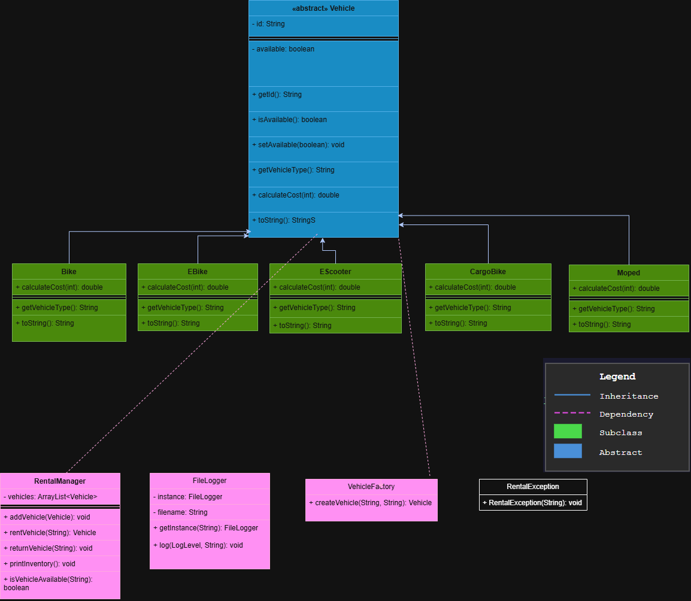
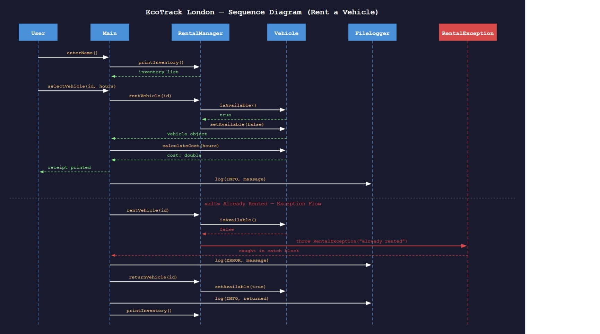

# EcoTrack London: Micro-Mobility Rental System

A console-based Java app for renting eco-friendly vehicles, built for a fictional London council initiative to cut traffic and pollution. Five vehicle types, a 15-vehicle live inventory, receipts, file logging and 8 JUnit tests, built on inheritance, polymorphism, and the Singleton and Factory patterns.

*First-year Object-Oriented Programming project (Computer Science and Cyber Security).*

## Why I built this

I loved building something that feels like a real system: vehicles go out, become unavailable, come back, get costed and logged, and every piece has to agree with every other piece or the whole thing breaks. That's what hooked me.

The part I'm proudest of is the design. I wanted it to be easy to grow, so I built one abstract `Vehicle` class with a subclass for each type, plus a Factory to create them. When I added the Moped halfway through, it took one new class and one new line, and nothing that already worked had to change. That's when OOP stopped being a lecture topic and became something I could actually feel working.

## Features

- Five vehicle types: Bike, EBike, EScooter, CargoBike and Moped, each with its own hourly rate
- A 15-vehicle inventory with live availability
- Automatic cost calculation, with a printed receipt
- Custom `RentalException` for invalid actions, such as renting a vehicle that is already out or an unknown ID
- Timestamped logging of rentals, returns and errors to `rental_log.txt`
- 8 JUnit tests covering cost calculation and rent/return behaviour
- Input validation: invalid hours (letters, zero, negatives) are rejected and the user is asked again

## Example run

```
=========================================
  Welcome to EcoTrack London
  Micro-Mobility Rentals
=========================================
Log in with your name: Sam

+---------------+-------------+-----------+--------------+
| Vehicle       | ID          | Rate/hr   | Availability |
+---------------+-------------+-----------+--------------+
| Bike          | LDN-OXF-01  | £3.99     | Available    |
| EBike         | LDN-CAM-01  | £8.75     | Available    |
| EScooter      | LDN-SHR-01  | £5.25     | Available    |
| ...           | ...         | ...       | ...          |
+---------------+-------------+-----------+--------------+

Enter the ID of the vehicle you want to rent: LDN-CAM-01
Enter number of hours: 3
EBike (LDN-CAM-01) rented successfully.

--- Rental Receipt ---
Customer:  Sam
Vehicle:   EBike
ID:        LDN-CAM-01
Duration:  3 hours
Total:     £26.25
----------------------
```

Every action is also written to `rental_log.txt`:

```
[29-10-2026 03:00:35] INFO: Sam rented EBike (LDN-CAM-01) for 3 hours. Cost: £26.25
[29-10-2026 03:00:35] INFO: Sam returned LDN-CAM-01
```

## OOP concepts and design patterns used

| Concept | Where |
|---|---|
| **Inheritance and abstraction** | Abstract `Vehicle` class, with five subclasses that each define their own `calculateCost()` |
| **Polymorphism** | `calculateCost()` runs the correct version for each vehicle type at runtime; `RentalManager` holds everything as `Vehicle` |
| **Encapsulation** | `id` and `available` are private in `Vehicle`, with access through getters and one setter |
| **Singleton pattern** | `FileLogger`: one shared logger for the whole program |
| **Factory Method pattern** | `VehicleFactory`: all vehicle creation in one place, so adding a type means one new subclass and one new `case` |
| **Custom exceptions** | `RentalException` gives clear, system-specific error messages |

## Project structure

```
src/
  Main.java            Entry point and console menu
  models/              Vehicle, Bike, EBike, EScooter, CargoBike, Moped
  services/            RentalManager, FileLogger, VehicleFactory
  exceptions/          RentalException
test/
  RentalTest.java      JUnit 5 tests
lib/
  junit-platform-console-standalone-1.10.0.jar
diagrams/
  uml-class-diagram.png
  sequence-diagram.jpeg
```

## Diagrams

**Class diagram**



**Sequence diagram (rental flow)**



## Requirements

Java JDK 17 or later (developed and tested with Java 21).

## Build and run

From the project root:

```bash
# Compile the app
javac -encoding UTF-8 -d bin $(find src -name "*.java")

# Run it
java -cp bin Main
```

On Windows (Command Prompt), list the files instead of using `find`:

```bat
javac -encoding UTF-8 -d bin src\Main.java src\models\*.java src\services\*.java src\exceptions\*.java
java -cp bin Main
```

## Run the tests

```bash
javac -encoding UTF-8 -d bin -cp lib/junit-platform-console-standalone-1.10.0.jar $(find src test -name "*.java")
java -jar lib/junit-platform-console-standalone-1.10.0.jar -cp bin --scan-classpath
```

All 8 tests should pass.

## Vehicle rates

| Vehicle   | Rate per hour |
|-----------|---------------|
| Bike      | £3.99 |
| EBike     | £8.75 |
| EScooter  | £5.25 |
| CargoBike | £6.99 |
| Moped     | £9.50 |

## What I learned

- **Design before code:** planning the UML class and sequence diagrams first made the code easier to write and change.
- **Extending without breaking:** adding the Moped later meant one new subclass and one new line in VehicleFactory, with no changes to existing classes. That’s the Open/Closed principle in practice.
- **Testing:** writing JUnit tests (Arrange, Act, Assert) showed me how much a failing test tells you before a user ever sees the bug.
- **Small details matter:** my errors were mostly Java’s strict file naming and case sensitivity, which taught me to match file names to class names exactly. 

## Known limitations

These were deliberate scope decisions for the coursework:

- One customer session at a time (no accounts or login; the user just types a name)
- Vehicles are hardcoded at startup instead of loaded from a database
- Cost is calculated but no payment is processed
- No maximum rental duration
- A session allows up to two rentals.

## Possible improvements

- Load vehicles from a database or file
- Add user registration and booking for future dates
- Add payment handling
- Show only available vehicles, with a short description of each type